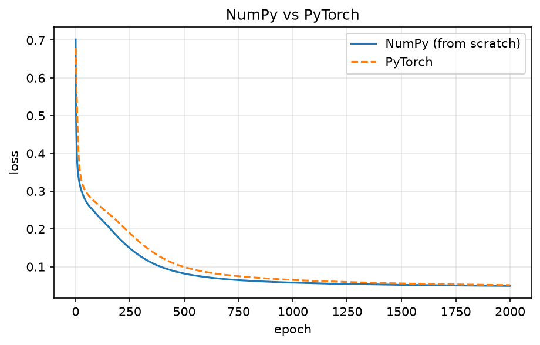
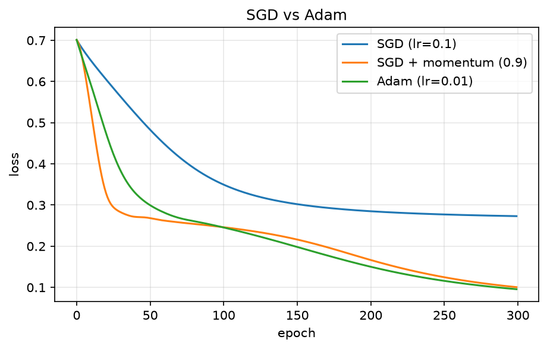
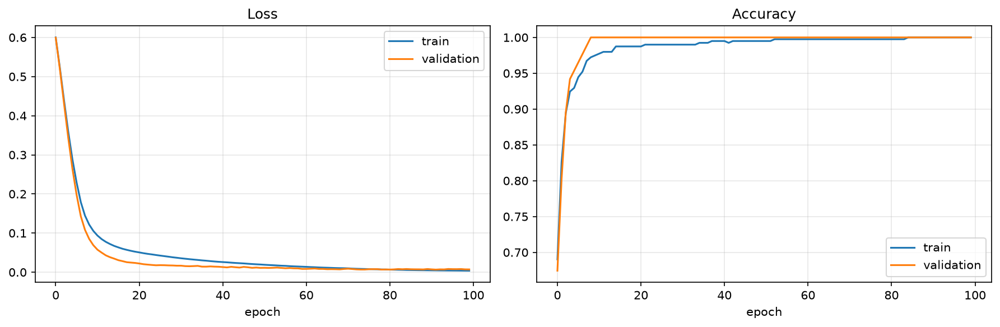
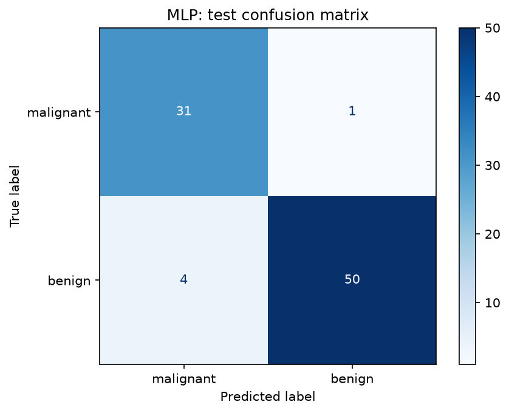
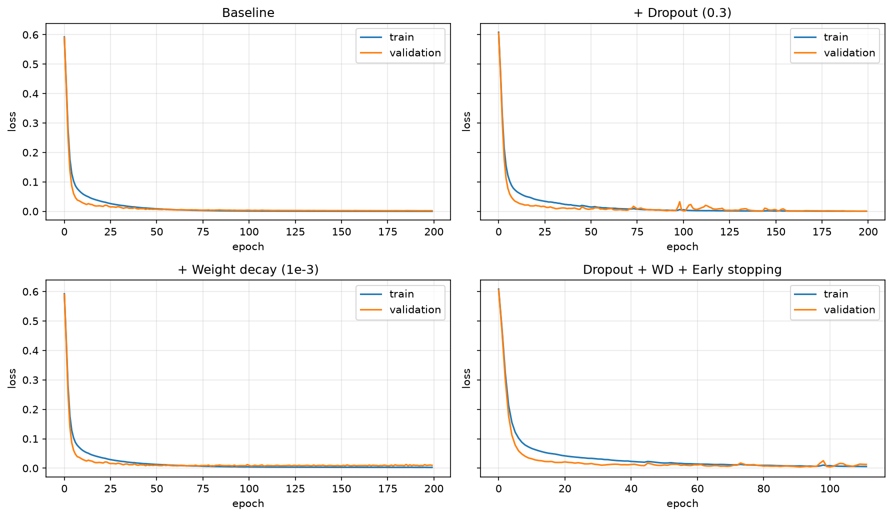
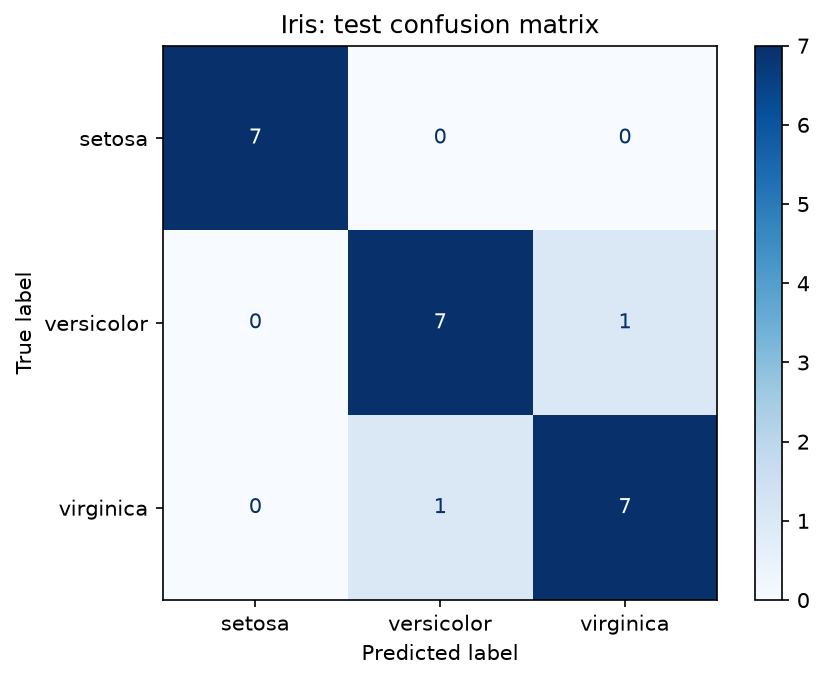

# Deep Learning Phase 1: Foundations of Neural Networks

A five-day project in which I built a fully connected neural network (MLP) from scratch in NumPy, rebuilt it in PyTorch, and used it for binary and multi-class classification on tabular data.

## Goals

- Understand how a basic MLP works: neuron, activation, forward pass, loss, backpropagation.
- Implement forward, backward and update by hand in NumPy and verify the gradients numerically.
- Rebuild the same network in PyTorch and compare it with the NumPy version.
- Compare optimizers (SGD, SGD with momentum, Adam).
- Train a binary classifier on the Breast Cancer dataset and compare it honestly with classical models.
- Study overfitting and apply regularization (dropout, weight decay, early stopping).
- Train a multi-class classifier on Iris.

## Repository structure

```
.
├── README.md
├── NOTES.md                                  # theory notes, Day 1 to Day 5
├── requirements.txt
├── images/                                   # plots used in this README
└── notebooks/
    ├── day1_neuron_forward_pass.ipynb        # NumPy: activations, neuron, forward pass
    ├── day2_backprop_mlp_from_scratch.ipynb  # NumPy: loss, backprop, MLP class, gradient check
    ├── day3_pytorch_notebook2.ipynb          # PyTorch rebuild, NumPy vs PyTorch, SGD vs Adam
    ├── day4_breast_cancer_mlp.ipynb          # Breast Cancer binary classifier
    └── day5_regularization_iris.ipynb        # Regularization + Iris multi-class
```

## Setup

The notebooks run on Google Colab (no GPU needed). To run locally:

```
pip install -r requirements.txt
jupyter notebook
```

## Day-by-day summary

| Day | Topic | Notebook |
|---|---|---|
| 1 | Neuron, activations (ReLU, Sigmoid, Tanh), forward pass in NumPy | `day1_neuron_forward_pass.ipynb` |
| 2 | Loss functions, backpropagation, MLP class, training on `make_moons`, gradient check | `day2_backprop_mlp_from_scratch.ipynb` |
| 3 | PyTorch basics, NumPy vs PyTorch comparison, SGD vs Adam | `day3_pytorch_notebook2.ipynb` |
| 4 | Breast Cancer MLP, evaluation, comparison with classical models | `day4_breast_cancer_mlp.ipynb` |
| 5 | Regularization, early stopping, multi-class classifier on Iris | `day5_regularization_iris.ipynb` |

## Part 1: MLP from scratch (NumPy)

- **Dataset:** `make_moons`, 500 samples, noise 0.2, stratified 80/20 train/test split, random_state 42.
- **Model:** `2 -> 16 -> 1`, ReLU hidden layer, sigmoid output, binary cross-entropy loss.
- **Training:** full-batch gradient descent, learning rate 0.5, 2000 epochs.
- **Backpropagation** (written by hand):

```
dZ2 = (A2 - y) / m
dW2 = A1.T @ dZ2          db2 = sum(dZ2)
dZ1 = (dZ2 @ W2.T) * (Z1 > 0)
dW1 = X.T @ dZ1           db1 = sum(dZ1)
```

| Metric | Result |
|---|---|
| Train accuracy | 0.980 |
| Test accuracy | 0.990 |
| Gradient check (analytic vs numerical, relative error) | about 1e-10 |

The gradient check compares the backpropagation gradient with the central-difference estimate `(L(w + eps) - L(w - eps)) / (2 * eps)` and agrees to about 1e-10 for the weights and biases I checked.

## Part 2: PyTorch re-implementation and optimizers

The same `2 -> 16 -> 1` network was rebuilt with `nn.Module`, `nn.Linear`, `BCEWithLogitsLoss` and `DataLoader`.

**NumPy vs PyTorch** (same setup: full-batch SGD, lr 0.5, 2000 epochs):

| Version | Final loss | Test accuracy |
|---|---|---|
| NumPy (from scratch) | 0.0493 | 0.990 |
| PyTorch | 0.0514 | 0.990 |

The two versions reach almost the same loss and the same accuracy. The small loss difference is expected because the initial weights are different. This confirms that the hand-written backpropagation behaves like PyTorch's autograd.



**SGD vs SGD with momentum vs Adam** (same initial weights, full-batch, 300 epochs):

| Optimizer | Final loss | Test accuracy |
|---|---|---|
| SGD (lr 0.1) | 0.2730 | 0.860 |
| SGD + momentum 0.9 (lr 0.1) | 0.1006 | 0.980 |
| Adam (lr 0.01) | 0.0956 | 0.980 |

Plain SGD was still far from converged after 300 epochs, while momentum and Adam reached a much lower loss in the same number of steps. Note that this is not a fully controlled comparison: Adam used a different learning rate (0.01) from the SGD variants (0.1), and only one run per optimizer was made.



## Part 3: Binary classifier on the Breast Cancer dataset

- **Data:** scikit-learn Breast Cancer, 569 samples, 30 features (212 malignant = class 0, 357 benign = class 1).
- **Split:** stratified 70/15/15 (train/validation/test), `random_state=42`.
- **Preprocessing:** `StandardScaler` fitted on the training set only, to avoid data leakage.
- **Model:** PyTorch MLP `30 -> 32 -> 16 -> 1`, ReLU, `BCEWithLogitsLoss`, Adam (lr 0.001), batch size 32, 100 epochs.
- **Tracked per epoch:** train and validation loss and accuracy.



### Test-set results (86 samples)

The classical baselines were trained on the same split and the same scaled data (Logistic Regression with `max_iter=1000`, SVM with RBF kernel and `C=1.0`, Random Forest with 200 trees).

| Model | Accuracy | Precision | Recall | F1 |
|---|---|---|---|---|
| MLP (PyTorch) | 0.942 | 0.980 | 0.926 | 0.952 |
| Logistic Regression | 0.965 | 0.981 | 0.963 | 0.972 |
| SVM (RBF) | 0.965 | 0.981 | 0.963 | 0.972 |
| Random Forest | 0.919 | 0.961 | 0.907 | 0.933 |

Precision, recall and F1 in this table use the benign class (label 1) as the positive class.

Per-class report for the MLP:

| Class | Precision | Recall | F1 | Support |
|---|---|---|---|---|
| Malignant | 0.89 | 0.97 | 0.93 | 32 |
| Benign | 0.98 | 0.93 | 0.95 | 54 |

The MLP classified 31 of 32 malignant samples and 50 of 54 benign samples correctly (81 of 86 in total). The one malignant case it missed is the costliest kind of error in this setting, and its malignant recall of 0.97 is the number that matters most here.



Over 5 different seeds, the MLP reached a test accuracy of 0.942 +/- 0.000. The identical result suggests that the same five test samples were misclassified every time, so the seed made little difference on this split.

**Did the MLP beat the classical models?** No. On this split, Logistic Regression and SVM scored 0.965 against 0.942 for the MLP, and the MLP beat only the Random Forest (0.942 vs 0.919 accuracy). The gap between the MLP and SVM is about two test samples, which is small and could be noise on an 86-sample test set. My Week 3 SVM reached about 0.98 on a different split, so that number is not directly comparable to this table. This matches what is typically seen on small tabular data: there is little data to train a neural network with many parameters, and the features are already informative, so simpler models usually match or beat it.

## Part 4: Regularization

I started from the Day 4 setup with a slightly larger model (`30 -> 64 -> 32 -> 1`, Adam lr 0.001, batch size 32, up to 200 epochs, same split) so that overfitting would be easier to see. I then compared four setups: no regularization, dropout (0.3), weight decay (1e-3), and dropout + weight decay + early stopping (patience 20 on validation loss, best weights restored).

| Setup | Epochs trained | Best val loss | Final train loss | Final val loss | Gap (val - train) | Test accuracy |
|---|---|---|---|---|---|---|
| Baseline | 200 | 0.0019 | 0.0001 | 0.0021 | 0.0020 | 0.942 |
| + Dropout (0.3) | 200 | 0.0002 | 0.0004 | 0.0006 | 0.0002 | 0.942 |
| + Weight decay (1e-3) | 200 | 0.0073 | 0.0028 | 0.0098 | 0.0070 | 0.942 |
| Dropout + WD + Early stopping | 112 | 0.0043 | 0.0058 | 0.0128 | 0.0071 | 0.953 |

"Final" losses are from the last epoch that was trained. For the early-stopping run, the model weights were restored to the best epoch, so its final-epoch validation loss (0.0128) is higher than its best (0.0043).



What I observed:

- On this dataset, overfitting was very mild. In the baseline, the best and final validation losses were almost the same (0.0019 and 0.0021), so there was little room for regularization to improve.
- Dropout gave the smallest train-validation gap. Weight decay and the combined setup produced higher losses, most likely because they keep the model less confident on its predictions.
- Early stopping reduced training from 200 to 112 epochs with similar accuracy.
- Test accuracy was 0.942 for three setups and 0.953 for the combined one. That difference is one test sample (81 vs 82 out of 86), which is within noise, so I do not claim that regularization improved accuracy here.

## Part 5: Multi-class classifier on Iris

- **Data:** Iris, 150 samples, 4 features, 3 balanced classes. Stratified 70/15/15 split (104/23/23), scaler fitted on the training set only.
- **Model:** MLP `4 -> 16 -> 8 -> 3`, ReLU, `CrossEntropyLoss` on raw logits (softmax is applied only to display probabilities), Adam (lr 0.01), batch size 16, 200 epochs.
- **Test accuracy:** 0.913 (21 of 23 samples).

| Class | Precision | Recall | F1 | Support |
|---|---|---|---|---|
| Setosa | 1.00 | 1.00 | 1.00 | 7 |
| Versicolor | 0.88 | 0.88 | 0.88 | 8 |
| Virginica | 0.88 | 0.88 | 0.88 | 8 |

Setosa was classified perfectly. The two errors were one versicolor predicted as virginica and one virginica predicted as versicolor, which are the two classes that overlap in feature space. One of the misclassified samples had predicted probabilities of 0.525 and 0.475, so the model was almost undecided there. Training and validation accuracy both reached 1.000, while the test set has only 23 samples, so one mistake changes accuracy by about 4%.



## What I learned

- A neuron computes a weighted sum plus bias and passes it through a non-linear activation. Without non-linearity, stacked layers collapse into a single linear layer.
- Forward propagation computes predictions; backpropagation uses the chain rule to compute the gradient of the loss for every weight; the optimizer uses those gradients to update the weights.
- A gradient check is a reliable way to verify a hand-written backward pass, and my NumPy version matched PyTorch's autograd.
- Momentum and Adam reached a much lower loss than plain SGD in the same number of steps in my experiment, though it was a single run with different learning rates.
- Scalers must be fitted on the training data only, and the test set must be used only once at the end.
- Accuracy alone can hide errors, so precision, recall, F1 and the confusion matrix matter, especially for medical data.
- Neural networks do not always beat simpler models on small tabular data: here Logistic Regression and SVM scored higher than the MLP.
- Regularization is not guaranteed to help. On this small, easy dataset there was little overfitting, so dropout, weight decay and early stopping changed the curves but not the test accuracy in a meaningful way. Early stopping did cut training from 200 to 112 epochs (about 44% fewer).
- With very small test sets (86 and 23 samples), a difference of one or two samples is within noise, so conclusions need to be stated carefully.

See [NOTES.md](NOTES.md) for the detailed theory notes.

## Tools

Python, NumPy, pandas, matplotlib, scikit-learn, PyTorch, Google Colab.
